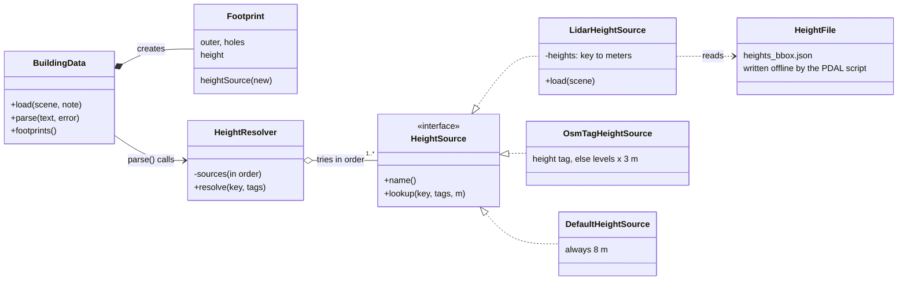
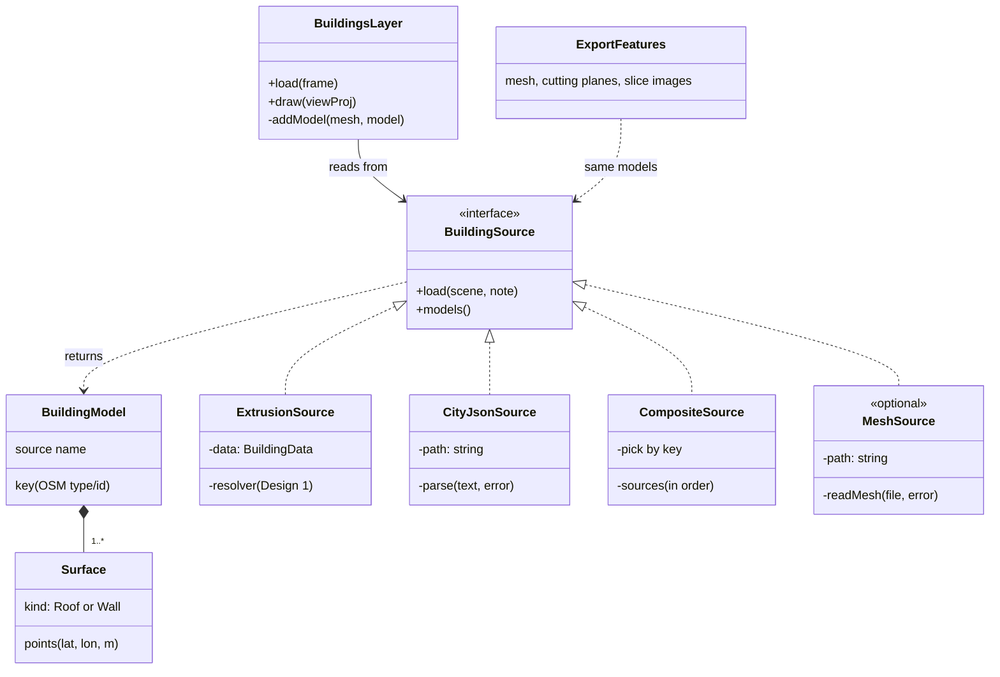

# Writing 5: Design of Measured Building Geometry

*Export to 3D Print extension, Sprint 2*

Qiming Lyu · Team Export to 3D Print (Group 9) · CSCI 3081W, Fall 2026  
November 15, 2026

## Introduction

Our team’s extension exports a Gopher GIS scene as a 3D mesh and as matching stacks of cutting planes and slice images, so that the scene can be built as a physical model by 3D printing or by laser-cutting stacked layers. My Sprint 1 research [1] asked how the buildings in that export could look like the real ones. That task has two major parts. *Geometry* is the solid shape of a building: its height, its roof and its massing.[^1] *Texture* is what covers that shape, such as roof color and wall material. This document designs the geometry part, which is my feature for Sprint 2. Texture is a separate feature that builds on it, so I return to it only where the designs affect it.

The feature is *measured building geometry*: replace the guessed block that stands in for every building with a shape measured from public data. It fits the extension as its input. The other export features our team has planned (the mesh export, the cutting planes and the slice images) all read building shapes, so their output can only be as true as those shapes. The feature also feeds back into Gopher GIS itself. In the base prototype every building is a gray box, so better building data improves the 3D view for every team, with or without our export.

The technical problem is that the prototype’s buildings carry almost no 3D information. Each one is its OpenStreetMap (OSM) footprint[^2] extruded straight up to one height with a flat roof ([`extrudeFootprint`](https://github.com/csci-3081-20-f26/csci-3081-students-sprint-1-prototype-and-research-group-9/blob/633898d5006ebe1ad46569516fb69f0e32bee508/src/Buildings.cpp#L357)), a form that 3D city modeling calls LOD1.[^3] The height is the OSM `height` tag, else `building:levels` × 3 m, else a default of 8 m ([`buildingHeight`](https://github.com/csci-3081-20-f26/csci-3081-students-sprint-1-prototype-and-research-group-9/blob/633898d5006ebe1ad46569516fb69f0e32bee508/src/Buildings.cpp#L195)). In the prototype’s data, 46,364 of 50,754 buildings (91.4%) fall through to the default, and none of the 109 buildings in the campus view has a `height` tag [1]. A building with parts of different heights is still a single block, because the app reads only whole-building outlines and never OSM’s `building:part` outlines [3]. For our extension this is more than cosmetic. Every horizontal slice of a block is the same outline, so the cutting planes of a campus of blocks are stacks of identical shapes at guessed heights.

Both designs below start from the same measurement. Sprint 1 found that the whole data area is covered by public-domain 2022 USGS lidar[^4] at about 64 points per square meter [4, 5], which is dense enough to measure every roof. Processing it needs the PDAL library [6], which is no longer packaged in current Debian or Ubuntu [7]. In both designs, therefore, a team script processes the lidar offline, in Docker or conda, and the app only reads the result. The designs differ in what that result is and in how much of the app has to change to use it.

## Design 1: A height file behind a chain of height sources

Design 1 keeps the block model and fixes the number. Offline, the script computes each lidar point’s height above ground with PDAL’s height-above-ground filters [6] and collects the points that fall inside each OSM footprint. The vendor did not classify building points [8], so the footprint does the selecting. A high percentile of those points (90th to 98th) becomes the building’s height. The script writes one JSON file, `heights_<S>_<W>_<N>_<E>.json`, into the app’s `data/osm` folder beside the buildings file, with the bounding-box naming that the app’s `datafiles::find` already matches. Each entry is keyed by OSM type and ID, such as `way/123`, because OSM numbers ways and relations separately.

In the app, the hard-coded call to `buildingHeight` in [`BuildingData::parse`](https://github.com/csci-3081-20-f26/csci-3081-students-sprint-1-prototype-and-research-group-9/blob/633898d5006ebe1ad46569516fb69f0e32bee508/src/Buildings.cpp#L244) becomes a call to a `HeightResolver` (Figure 1). The resolver holds an ordered list of `HeightSource` objects and returns the first answer. There are three sources: `LidarHeightSource` looks the building up in the height file, `OsmTagHeightSource` wraps the existing tag parsing, and `DefaultHeightSource` returns 8 m. Each source is a Strategy, the pattern we practiced in Lab 9, and the ordered list is a small Chain of Responsibility [9]. The resolver also records which source answered in a new `Footprint::heightSource` field, so the on-screen notes can report how many buildings are measured and how many are still guessed. Nothing else changes. `extrudeFootprint`, `BuildingsLayer` and any exporter that reads `Footprint::height` get true heights without knowing where they came from.

**Figure 1.** Design 1 class diagram. `BuildingData` and `Footprint` are existing classes and the rest are new. Only `parse` and `Footprint` change in the existing code.

I would implement it in three steps. The first is the offline script, tried on about 1 km² of campus. The second is the four new classes, unit-tested against a small hand-written height file, which is possible because `BuildingData` contains no OpenGL. The third is the one-line swap in `parse`. The design adds no library, since the app already bundles nlohmann/json. The result is every one of the roughly 51,000 buildings at its measured height. The limit is the model itself. Roofs stay flat, and a building gets one height, so a tower on a wide base becomes one tall block.

## Design 2: A building model behind source adapters

Design 2 replaces the footprint-plus-height model with surfaces, which lets a building have any roof and several heights. Offline, the open-source tool roofer [10] takes the same lidar and footprints and reconstructs each building as roof planes and walls. It writes CityJSON [11], an open JSON format for 3D city models in which each surface can be labeled as roof, wall or ground. Its most detailed output is LOD2: sloped roof planes, and separate volumes wherever the height jumps inside a footprint [2]. Setbacks[^5] and a tower rising from a lower base therefore appear as they are. roofer is licensed under GPLv3, which is a second reason to run it as a separate offline tool and not link it into the app. The offline step would also convert the file’s projected coordinates to the latitude and longitude the app uses, so the app needs no map-projection library.

In the app, a new interface, `BuildingSource`, returns `BuildingModel` objects, each a list of labeled `Surface` polygons (Figure 2). Each implementation is an Adapter [9] from one data format to that common model. `ExtrusionSource` wraps today’s `BuildingData` and produces the familiar block as one roof surface and its walls, with Design 1’s resolver supplying the height. `CityJsonSource` parses roofer’s file with the bundled nlohmann/json and triangulates it with the bundled earcut. `CompositeSource` asks the detailed source first and falls back to the block for any building the detailed file does not cover, so partial data never leaves holes in the map. `BuildingsLayer` no longer calls `extrudeFootprint`. It builds its mesh from whatever surfaces the source returns, and the export features read the same models, so the screen and the exported files cannot disagree.

**Figure 2.** Design 2 class diagram. `BuildingsLayer` is an existing class and the rest are new. `ExportFeatures` stands for our team's other features. `ExtrusionSource` produces today's block (LOD1), `CityJsonSource` reads roofer's output (LOD2), and `CompositeSource` picks the most detailed model available for each building. `MeshSource` is the optional enhanced level covered in the Discussion (LOD3).

I would implement it in four steps: run roofer on the campus pilot area and inspect its output; define `BuildingModel` and move today’s extrusion behind `ExtrusionSource` with no visible change; add `CityJsonSource`; and finally switch the layer and the exporters to `CompositeSource`. This design costs more. It changes a data model that the display and our team’s mesh export both touch, so it has to be coordinated with that feature. It also rests on a tool I have not run. How roofer behaves on lidar without building classification, how long it takes on 51,000 buildings, and whether it carries OSM IDs and surface labels through to its output are all untested.

## Discussion

Working through both designs taught me that they are less different than they look. They share the data and the offline step, and Design 1’s resolver survives inside Design 2’s `ExtrusionSource`, so Design 1 is not thrown away if Design 2 follows. The real difference is the question the app asks of its data. Design 1 asks how tall an outline is. Design 2 asks which surfaces make up a building. The second question is the more general one, and that generality is what it costs.

Both designs also share a limit. Lidar is flown from above, so it sees only the top of everything. Each design therefore gives one height for each point on the ground, with walls that drop straight down from the roof edge. That suits a building whose character is its outline and roof. It does not suit a building whose character is in its walls: a structural frame that stands a meter proud of the glass, recessed balconies, or upper floors that overhang the ground floor. Depth of this kind is facade relief,[^6] and LOD2 flattens it.

Capturing it is a third level, which I treat as an optional enhanced design and not as part of this feature. The building becomes a full 3D mesh (LOD3). It is made by photogrammetry[^7] from ground-level photos with free tools such as COLMAP and OpenMVS [12, 13], or modeled by hand from the digitized blueprints that the University Archives hold for some campus buildings [14]. Either way the lidar roof goes on top, because the roof cannot be seen from the ground. In the app it is one more adapter, the dashed `MeshSource` in Figure 2, and `CompositeSource` would prefer it for the buildings that have one. It is optional because it is expensive in a different way. It takes days of work per building, so it suits only one or a few chosen buildings. Its meshes are often not watertight, that is, not closed solids. Overhangs also break the assumption that lets the team slice the scene as a simple height map, so those buildings would need true mesh slicing, for example with the Manifold library [15]. Design 1 has no place to put such a mesh. Design 2 does, without changing its interface.

Table 1 compares the three levels. Print scale decides between them. It is our team’s decision, and it is still open. A desktop printer resolves about 0.4 mm [16]. If the model shows the whole 9.4 × 7.8 km data area at about 1:20,000, only relative heights survive, and Design 1 delivers everything that can be seen. If it shows a few campus buildings at about 1:500, roof shapes and wall depth are several millimeters in size, so Design 2 earns its cost and the enhanced level becomes visible. I would choose Design 1 alone when the scale is small, when time is short, or when roofer fails its pilot. I would choose Design 2 when the scale is large enough to show roofs. I would also choose it when texture matters, because its roof and wall labels are where roof photos and wall materials attach, while a Design 1 block can carry only one roof color and one wall tint.

**Table 1.** The two designs and the optional enhanced level.

| | Design 1: height file | Design 2: building model | Optional: facade relief |
|:--|:--|:--|:--|
| Shape captured | True height, flat roof (LOD1) | Roof shape, setbacks, parts at different heights (LOD2) | Depth on the walls, overhangs (LOD3) |
| Offline data | Lidar and footprints, with PDAL | Lidar and footprints, with roofer | Ground photos or blueprints, per building |
| Coverage | All 51,000 buildings | Campus first; whole area if run time allows | One or a few buildings |
| App change | Four small classes; one call in `parse` | New model and interface; layer and exporters change | One more adapter; true mesh slicing |
| New libraries | None | None | A mesh reader and a mesh slicer |
| Main risk | Low; percentile choice is untested | roofer is untested on this lidar | Days per building; meshes that are not watertight |
| At 1:20,000 | 8 m height is 0.4 mm | 3 m roof rise is 0.15 mm | 1 m frame depth is 0.05 mm |
| At 1:500 | 8 m height is 16 mm | 3 m roof rise is 6 mm | 1 m frame depth is 2 mm |

## Conclusion

I recommend building Design 1 now and shaping it so that Design 2 can follow. Design 1 replaces the 8 m guess that 91% of buildings get today with one data file, four small classes and no new library, and it helps at every scale, in the base viewer as much as in our export. Its resolver should be written as the class that Design 2’s `ExtrusionSource` will later wrap. Design 2 should follow for the campus if our team chooses a print scale large enough to show roofs and roofer passes a pilot. Facade relief should stay optional, for one chosen building, and only after Design 2 exists.

One decision is our team’s own: print scale, which decides whether Design 2 is worth its cost. Two decisions belong to the instructor team. The first is whether an offline preprocessing step outside the C++ app is acceptable, since both designs depend on it. The second concerns the Gopher GIS refactor. If layers received their data through an interface like `BuildingSource`, and data classes stayed free of OpenGL as `BuildingData` already is, any team could swap in better data and tests could run without a window.

Neither design has been built or run yet, so the next step is the lidar pilot on about 1 km² of campus that my Sprint 1 research proposed: measured heights for the 109 campus-view buildings, and one roofer run to settle its unknowns. Three smaller points are worth a look. Fetching OSM `building:part` outlines [3] would give stepped shapes for the buildings that mappers have already modeled, at no data cost. The viewer’s vertical exaggeration stretches terrain but not buildings, which the export must handle on purpose and not by accident. Finally, texture is the second half of my task and should be designed next, starting with roof color from the public-domain 2025 Twin Cities orthophoto [17].

[^1]: *Massing*: the overall arrangement of a building’s volumes, for example a tall tower standing on a wider, lower base.

[^2]: *Footprint*: the outline of a building on the ground, as seen from directly above.

[^3]: *LOD* (level of detail): the standard scale for 3D building models. LOD1 is a flat-topped block, LOD2 adds the roof shape, and LOD3 adds detail on the walls [2].

[^4]: *Lidar*: laser ranging from an aircraft. It returns a cloud of measured 3D points on the ground, roofs and trees.

[^5]: *Setback*: a step where the upper floors are narrower than the floors below, common near the top of older towers.

[^6]: *Facade*: an exterior wall face of a building. *Facade relief* is its depth, meaning anything that projects from the wall plane or is recessed into it.

[^7]: *Photogrammetry*: reconstructing a 3D surface from many overlapping photographs.

## References

[1] Q. Lyu, Building realism research for Sprint 1 (report, topic notes and sources), summarized in Writing 4. <https://github.com/csci-3081-20-f26/csci-3081-students-sprint-1-prototype-and-research-group-9/tree/ming/building-realism-research/docs/ming-building-realism-research>

[2] F. Biljecki, H. Ledoux and J. Stoter, “An improved LOD specification for 3D building models,” *Computers, Environment and Urban Systems* 59 (2016), 25–37. <https://doi.org/10.1016/j.compenvurbsys.2016.04.005>

[3] OpenStreetMap Wiki, Simple 3D Buildings (`building:part`). <https://wiki.openstreetmap.org/wiki/Simple_3D_Buildings>

[4] USGS 3DEP Elevation Index, MN\_CentralMissRiver\_B22 quality level. <https://index.nationalmap.gov/arcgis/rest/services/3DEPElevationIndex/MapServer/24>

[5] OpenTopography, MN\_CentralMissRiver\_4\_B22 dataset page. <https://portal.opentopography.org/usgsDataset?dsid=MN_CentralMissRiver_4_B22>

[6] PDAL height-above-ground filters (`filters.hag_nn`, `filters.hag_delaunay`). <https://github.com/PDAL/PDAL/commit/9a3a9445bc3f6e452c2fadf8970df1eb75ab28bc>

[7] Repology, PDAL versions. <https://repology.org/project/pdal/versions>

[8] Woolpert, MN Central Mississippi River 4 2022 Lidar Mapping Report. <https://rockyweb.usgs.gov/vdelivery/Datasets/Staged/Elevation/metadata/MN_CentralMissRiver_B22/MN_CentralMissRiver_4_B22/reports/MN_Central_Miss%20_River_4_2022_Lidar_Mapping_Report.pdf>

[9] E. Gamma, R. Helm, R. Johnson and J. Vlissides, *Design Patterns: Elements of Reusable Object-Oriented Software*. Addison-Wesley, 1994.

[10] 3DBAG, roofer, and roofer v1.0.0 release. <https://github.com/3DBAG/roofer>, <https://github.com/3DBAG/roofer/releases>

[11] CityJSON Specifications 2.0.1. <https://www.cityjson.org/specs/2.0.1/>

[12] COLMAP. <https://github.com/colmap/colmap>

[13] OpenMVS. <https://github.com/cdcseacave/openMVS>

[14] UMedia, University Archives blueprint record. <https://lib-umedia-prd-app-01.oit.umn.edu/item/p16022coll244:686.json>

[15] Manifold. <https://github.com/elalish/manifold>

[16] TouchTerrain README (FDM detail limits). <https://github.com/ChHarding/TouchTerrain_for_CAGEO>

[17] Minnesota Geospatial Commons, Twin Cities 2025 orthoimagery metadata. <https://mnatlas.org/metadata/2025_7_county.html>
